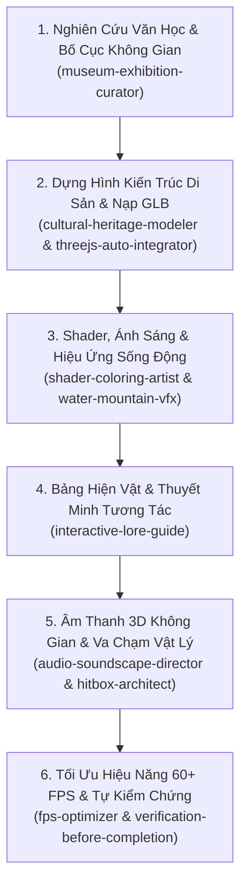

# Vietnamese 3D Museum Architect (Kỹ Sư Trưởng & Giám Đốc Nghệ Thuật Bảo Tàng 3D)

## Tổng Quan (Overview)
`museum-architect` là bộ kỹ năng và quy trình chuẩn hóa cấp cao nhất (Master Blueprint) của dự án **Bảo Tàng Văn Học 3D (Thánh Đường Văn Học)**. Kỹ năng này đóng gói toàn bộ quy trình từ ý tưởng văn học, quy hoạch không gian, dựng hình di sản văn hóa, lập trình shader/VFX, âm thanh procedural, va chạm vật lý, cho đến tối ưu hóa 60+ FPS và tự động kiểm chứng runtime WebGL.

---

## 1. Quy Trình 6 Bước Phát Triển Không Gian Trưng Bày



---

## 2. Chi Tiết Các Hạng Mục Kỹ Thuật

### Bước 1: Quy Hoạch Không Gian & Bố Cục Cảm Xúc (`museum-exhibition-curator`)
- **Phân khu chuyển tiếp:** Luôn chia không gian theo mạch cảm xúc tác phẩm (Dual-Zone tương phản hoặc 3-Stanza tuần tự).
- **Cổng chuyển cảnh:** Thiết kế cổng vòm đặc trưng (Vành trăng khuyết, Khóm trúc xứ Huế, Cổng ngọc bích...).
- **Xóa góc chết (Dead Corners):** Lấp đầy các góc khuất bằng bình phong chạm khắc, tàng kinh các thu nhỏ, chậu bonsai tứ quý, lư hương đỉnh đồng.
- **Quy tắc trục giao thông:** Tuyệt đối không đặt vật cản lớn trên trục tim đường đi (`|X| <= 2.3m` trên thảm đỏ / thảm trục thời gian).

### Bước 2: Kiến Trúc Di Sản & Nạp Mô Hình 3D (`cultural-heritage-modeler` & `threejs-auto-integrator`)
- **Hoa văn truyền thống:** Trống đồng Đông Sơn (Mặt trời 14 tia, chim Lạc), đài sen vàng 16 cánh, cột gỗ lim chạm mây cuốn, hoành phi câu đối sơn son thếp vàng.
- **Nạp mô hình qua helper:**
  ```javascript
  import { prepareUnlitVividGlbModel } from '../utils/modelLoaderHelper.js';
  // Chuẩn hóa tỷ lệ mét, ground Y=0, căn giữa X/Z, quét sạch NaN/Infinity
  const prepared = prepareUnlitVividGlbModel(gltf.scene, { targetSpan: 3.2 });
  ```
- **Tự vá lỗi hình học (Self-Healing Geometry):**
  ```javascript
  geo.computeVertexNormals();
  geo.computeBoundingBox();
  geo.computeBoundingSphere();
  ```

### Bước 3: Shader, Ánh Sáng Chiaroscuro & Living VFX (`shader-coloring-artist` & `water-mountain-vfx-sculptor`)
- **Custom GLSL Water Shader:** Mặt nước lăn tăn với độ trong suốt, màu xanh thẳm ngọc bích (`#064e3b`) chuyển dần sang lam ngọc (`#14b8a6`) và phản quang mặt trời (`uTime`).
- **Volumetric God Rays:** Luồng sáng hình nón cụt additive blending rọi từ giếng trời xuống mặt sàn hoặc cuốn sách trung tâm.
- **Living VFX:**
  - Khói trầm hương procedural (`Points` uốn lượn theo hàm sin/cos).
  - Đàn cá chép vàng bơi lượn uốn vây đuôi nhịp nhàng.
  - Cánh hoa đào / hoa sen rơi chao liệng chậm rãi.
  - Đom đóm lân tinh xanh ngọc lấp lánh nhẹ nhàng.

### Bước 4: Hệ Thống Bảng Hiện Vật & Thuyết Minh (`interactive-lore-guide`)
- **4 Chất liệu bảng:** Giấy Dó cổ truyền (`giay_do`), Lụa Trắng thanh tao (`lua_trang`), Đồng Cổ uy nghiêm (`dong_co`), Bản Khắc Đá rêu phong (`khac_da`).
- **4 Phần học thuật chuẩn hóa:**
  1. Hoàn cảnh sáng tác & Xuất xứ
  2. Bố cục & Mạch cảm xúc không gian
  3. Giá trị nhân đạo / Triết lý nhân sinh
  4. Lời bình & Dấu ấn thời đại
- Bọc nhãn tương tác đăng ký vào `LoreGuide` và phím `ESC` đóng sạch sẽ mà không mất ngữ cảnh camera.

### Bước 5: Âm Thanh Không Gian & Va Chạm (`audio-soundscape-director` & `hitbox-collision-architect`)
- **Procedural Web Audio:** Tạo âm thanh không gian không phụ thuộc file mp3 ngoài mạng:
  - Tiếng đàn bầu uốn nốt mềm mại.
  - Tiếng đàn tranh ngũ cung (Hò Xự Xang Xê Cống).
  - Tiếng sột soạt lật giấy Dó cổ truyền (`playVintagePageTurnSound`).
  - Tiếng nước róc rách thanh tịnh (`createTricklingWaterSound`).
- **Va chạm Box3 O(1):**
  ```javascript
  hitboxManager.registerSolidObjectCollider(null, {
    customBox: new THREE.Box3(minVec, maxVec),
    tag: 'Feature_SolidHitbox'
  });
  ```
- **WebXR Teleport:** Gắn cờ `userData.isTeleportFloor = true` trên mặt sàn di chuyển.

### Bước 6: Tối Ưu 60+ FPS & Tự Kiểm Chứng (`fps-optimizer` & `verification-before-completion`)
- **Gom cụm InstancedMesh:** Dùng cho cột gỗ, đèn lồng, lá sen, vệt nắng nghiêng, chậu cây.
- **Bỏ qua Raycaster:** Luôn gán `userData.ignoreRaycaster = true` trên toàn bộ hạt VFX, mặt nước, god rays, đèn trần.
- **Quy trình kiểm chứng 3 tầng:**
  1. `node --check <file>`: Đảm bảo không lỗi cú pháp, không sót biến undeclared.
  2. `npm.cmd run build`: Đảm bảo bundle sạch 100%, Exit Code 0.
  3. Headless Browser Runtime Test: 0 lỗi console, 0 lỗi 404/texture, FPS $\ge 60$.

---

## 3. Bản Mẫu Khởi Tạo Module Mới (Template Scaffold)

```javascript
import * as THREE from 'three';

export function createVietnameseExhibitionSpace({
  scene,
  hitboxManager = null,
  loreGuide = null,
  audioManager = null,
  cameraManager = null
} = {}) {
  const root = new THREE.Group();
  root.name = 'Vietnamese_Exhibition_Space_Root';

  // 1. Kiến trúc & bệ đỡ
  // 2. Hiện vật trung tâm & đèn chiếu Chiaroscuro
  // 3. Living VFX & Shader mặt nước
  // 4. Bảng thông tin hiện vật & lore registration
  // 5. Va chạm Box3 & WebXR Teleport
  // 6. Hàm update theo thời gian: root.userData.update = (timeSec) => { ... };

  return root;
}
```
